# rice

My own Hyprland desktop shell, built in Quickshell, one piece at a time,
replacing what HyDE / Waybar / dunst do today. Every surface shares one look:
dark liquid glass over Hyprland's blur, SF Pro text, smooth no-bounce motion
(see [docs/DESIGN.md](docs/DESIGN.md)).

## What's in it

| Piece | Replaces | Where |
|---|---|---|
| Glass HUD: brightness, volume, mic | HyDE volume popups, dunst brightness OSD | `shell/modules/osd/` |
| Notification server + Sonner-style toast stack; important ones (critical, a reply, an action) also peek out of the notch, and an agent finishing or needing you is a notch moment. Devices too: earbuds, a speaker, your IEMs behind a DAC, a mouse or a pad connecting or going grow a card out of the notch with the device, what happened and its battery (and once at login, what's already connected) | dunst | `shell/services/Notifs.qml`, `shell/modules/notifications/Popups.qml` |
| The center (Super+N): Notifications · Agents (kittymux, usage limits per account as in T3 Code) · Sound (coloured mixer, per-app output, device lists) · Controls (Wi‑Fi picker, Bluetooth, DND, Night Shift, Caffeine, Mic, Reduce Motion, battery, brightness) | dunst history, pavucontrol, nm-applet, brightness/hyprsunset scripts | `shell/modules/notifications/Center.qml` + `CenterContent.qml` + `*View.qml` |
| The clipboard island (Super+V): a pill at the top centre that shows each copy, and melts into a shelf of cards: fzf search, Quick Look, ⌃K actions, OCR, pins, rendered Markdown/code/Mermaid, secrets masked | HyDE's rofi cliphist menus | `shell/modules/clipboard/`, `shell/services/Clipboard.qml`, `bin/rice-clip`, `bin/rice-render` |

| The login screen and the lock screen: one design, the same password pill, status and motion | SDDM (astronaut theme), hyprlock | `greeter/`, `shell/greeter.qml`, `shell/modules/lock/` |
| The assistant (Super+Ctrl+Shift+A): a local agent on Ollama that uses tools (the focused window, system load, clipboard, selection, files in ~, web search) and asks before it runs a command, opens an app or a link; reasoning folds away; screenshots go to a vision model first when the chosen model can't see | — | `shell/modules/assistant/`, `shell/components/ai/`, `shell/services/OllamaService.qml`, `bin/rice_agent.py` |

Next up: dynamic island, control center, bar.

## Run / control

```sh
bin/rice start        # (re)start; stops dunst and takes org.freedesktop.Notifications
bin/rice stop         # dunst comes back by itself on the next notification
bin/rice logs         # follow the shell's log
bin/rice notifs dnd   # also: dnd-on dnd-off clear hide open last count waybar
bin/rice center [agents]   # toggle the center; starts the shell if it isn't running
```

Quickshell hot-reloads on save, so editing a `.qml` file updates the running
shell. The shell runs by path (`qs -p ~/Projects/rice/shell`), not `qs -c`,
because `~/.config/quickshell/shell.qml` exists and makes Quickshell ignore
named configs there.

## Shortcuts

| Keys | Does |
|---|---|
| Super+N | Notifications (again: close) |
| Super+Shift+N | Agents (kittymux); with the center open, switches tab |
| Super+Alt+N | Do Not Disturb on/off (the HUD confirms) |
| Super+Shift+Alt+N | Open the newest notification (its app, its thread) |
| Super+Ctrl+Shift+N | kittymux's own panel |

Inside the center: type to search · ↑↓ select · ↵ open · ⌦ dismiss (or mark
read) · →← expand/fold a group · ⇥ filter · ⌃⇥ next tab · ⌥1–4 a tab ·
⌃D Do Not Disturb · ⌃⇧⌫ clear all · Esc clears the search, then closes ·
? (or F1, ⌃/) shows every shortcut.

Inside the assistant: ↵ send · ⇧↵ newline · ⌃K model · / commands · ⌃V paste an image ·
⌃N new chat · ⌃O apps · ⌃M studio · ⌃B sidebar · ⌃↵ run (when it asks) · Esc don't run,
then stop, then close · ⌫ on an empty prompt removes the last attachment.

The Super shortcuts are Hyprland global shortcuts (`global, rice:center` …)
that call straight into the running shell (`shell/modules/Shortcuts.qml`):
no process per keypress. `hyprctl globalshortcuts` lists them.

## Layout

```
shell/
  shell.qml                 entry: instantiates the modules
  config/Theme.qml          design tokens (material, text, type, motion)
  components/               shared visuals (GlassCard, …)
  services/                 data + state singletons (Notifs, NotifAdapters, …)
  modules/                  surfaces (osd/, notifications/, …)
bin/                        rice (control CLI), rice-shell (launcher), rice-usage (usage limits, read-only)
hypr/                       kuwai: the Hyprland side (Lua) — see hypr/README.md
greeter/                    the login screen: install, sync, preview, its Hyprland config
waybar/                     Waybar module overrides (symlinked into ~/.config/waybar/modules)
docs/                       DESIGN.md (the look), BORROWING.md (what to take from where), media/ (README previews)
refs/                       shallow clones of other shells to read (gitignored)
```

## How it hooks into the system

- `~/.config/hypr/hyprland.lua` loads kuwai (`hypr/init.lua`), which autostarts
  `bin/rice-shell`, binds the shell's global shortcuts and gives every `rice-*`
  layer blur without animation, exempt from xray so the glass blurs real
  windows, not just the wallpaper. Details: [hypr/README.md](hypr/README.md).
- `~/.config/waybar/modules/custom-dunst.jsonc` → `waybar/custom-dunst.jsonc`
  keeps HyDE's bell working against the rice (or dunst, as fallback).
- dunst stays installed as the fallback. Its drop-ins in
  `~/.config/dunst/dunstrc.d/` (T3 Code, Ghostty) keep it presentable.
- Brightness events come from `~/Scripts/brightness.sh watch --part osd`.

## Usage limits (Agents tab)

`bin/rice-usage` reads T3 Code's own usage data: every provider and every
signed-in account (two Claude logins show as two segments), pushed live over
T3 Code's config subscription while the Agents tab is open. It only reads.
Give it a read-only token once:

```sh
umask 077; mkdir -p ~/.local/state/rice
t3 auth session issue --scope orchestration:read --label rice-usage --ttl 365d --token-only > ~/.local/state/rice/t3-token
```

Without a token, or with T3 Code closed, it falls back to kittymux's
`agent-usage.json` (one account per provider).

## Motion

Reduce Motion (Controls tab) turns travel, scale and stagger into plain
fades; it's remembered in `~/.local/state/rice/prefs.json`, and it's also on
when `RICE_REDUCE_MOTION=1` or Hyprland's animations are off. `hypr/kuwai/motion.lua`
gives Hyprland the same language: one ease-out, ~250ms in, ~160ms out, and a
critically damped spring for window moves (`kuwai motion reduced|off`).

## Login and lock screen

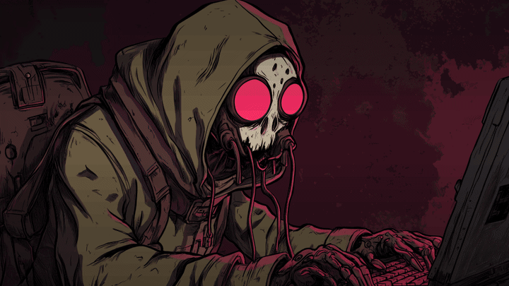

The login screen replaces SDDM and shows on every monitor, the Acer
included. greetd runs a bare Hyprland (`greeter/hyprland.lua`, same monitor
layout as the desktop) with the rice's own Quickshell login on it
(`shell/greeter.qml`). The lock screen (`rice lock`) is its sibling: the
same password pill, the same corner status, the same motion.

- **One axis, as on a Mac.** The art stays sharp at rest. The date, the
  clock and a greeting sit at the top centre (where the lock screen has its
  clock), your picture and name at the bottom centre with "Press any key to
  log in", and the power row under you. The first key or click focuses it
  in place: the art blurs and dims, the clock steps back, your picture
  grows and the password pill takes the hint's place.
- **Password pill.** Five dots pulse on every keystroke, so the length is
  never shown, and there's no show-password button. Caps Lock is flagged
  under the pill.
- **Status.** Bluetooth (when it's on), Wi-Fi bars or a cable, and the
  charge sit loose in the top-right corner, as on a Mac.
- **Power is held, never clicked.** Sleep, Restart and Shut Down fill a
  ring while you hold (0.8 s), then say goodbye. The island's power menu
  (Super+Backspace) works the same way.
- **Lock screen.** A blurred, drifting wallpaper sits behind the clock,
  the weather, what's playing and the notifications that matter.

| | |
|---|---|
| 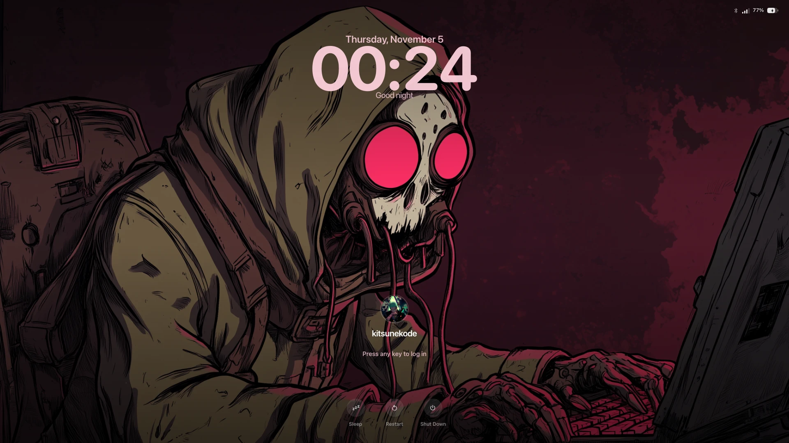 | 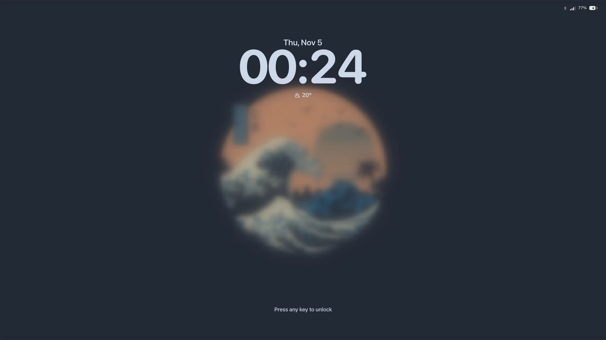 |
| 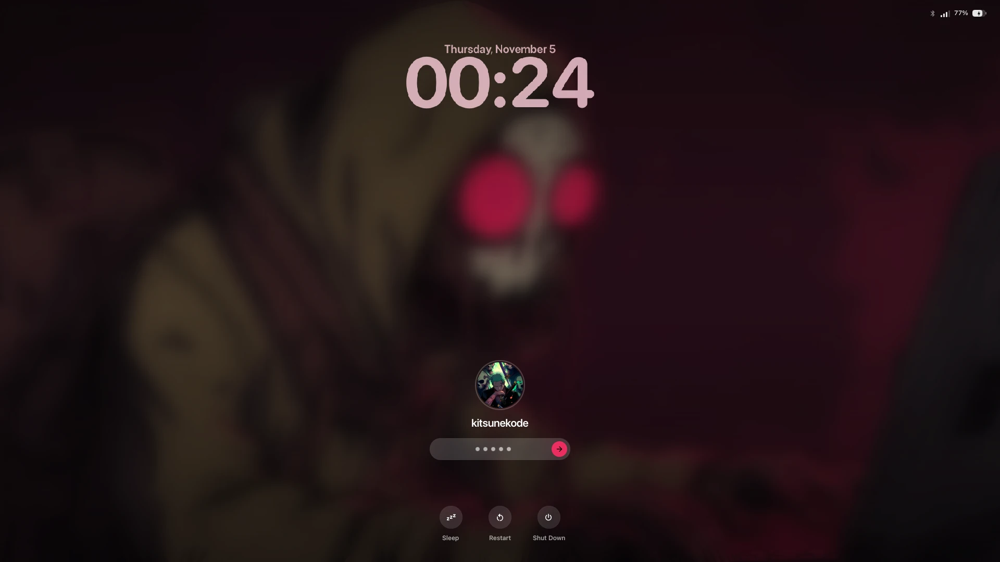 | 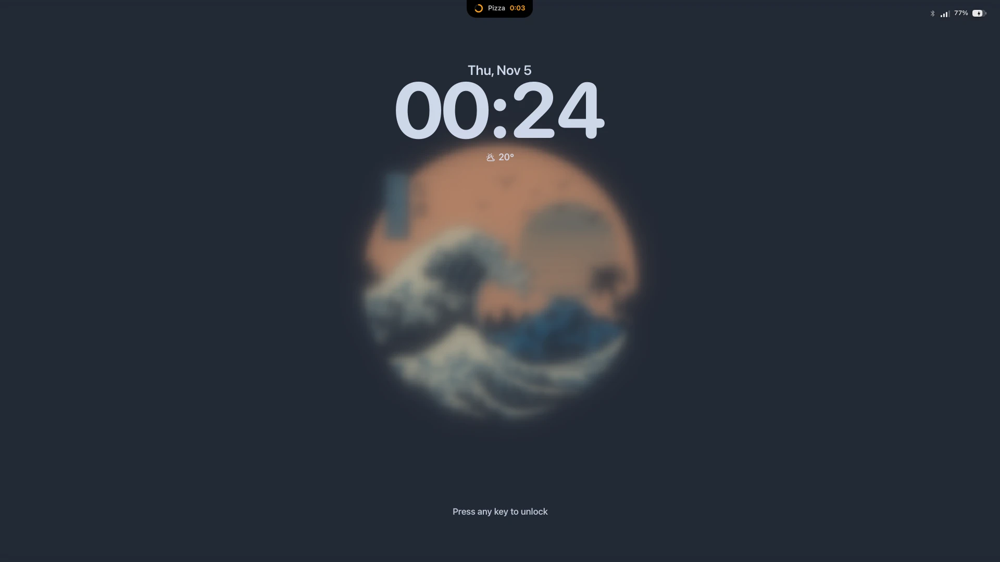 |

### Motion

Reduce Motion keeps only the fades.

| | |
|---|---|
| **Focusing the login.** The art blurs, the clock glides up, and you rise into the middle. | 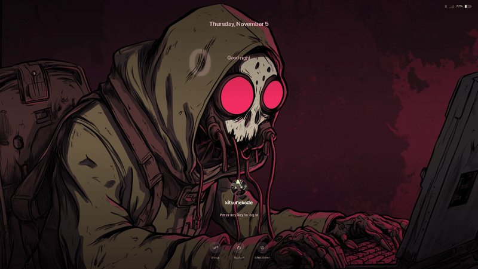 |
| **Logging in.** Your picture opens into your desktop's wallpaper with "Welcome back" over it, which is where the session starts. On the desktop, the notch then says "Good evening" with your picture, once per login. |  |
| **A wrong password.** The pill shakes and the ring around your picture flashes red. | 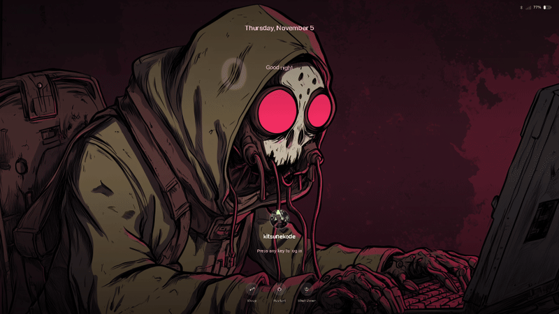 |
| **Hold to restart.** The ring fills, the label says what holding does, then the goodbye. | 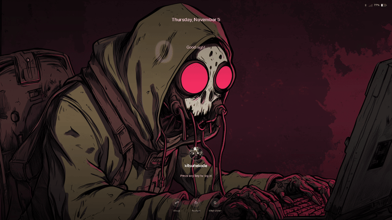 |
| **Goodbyes.** The screen goes quiet and a mark draws itself: an arrow round a circle to restart, the power symbol powering down, a breathing moon for sleep. The line under it reads "Good night, kitsunekode" late at night. Then black, and only then does it happen. |  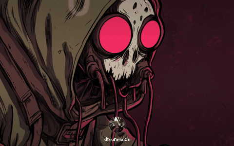 |
| **Locking.** The island opens out of a dot and the padlock's shackle snaps shut. | 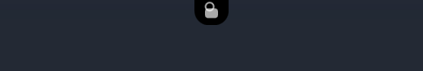 |
| **Unlocking.** The shackle springs open in green ("Unlocked"), the blur clears, and everything lifts off the wallpaper. The notch then says "Welcome back · away 42 min". | 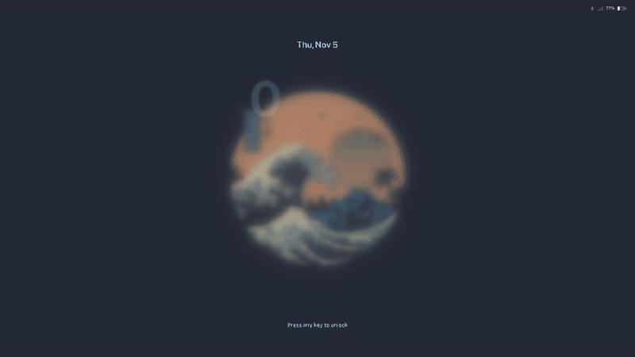 |
| **Notifications while locked.** A preview, as on an iPhone: the ones that matter (critical, warning, or something you can act on) since you last looked, with the app, when, the headline, one line, and the app's own status ("Needs you", "Completed"). A conversation is one card with a count. A verification code reads "Code hidden · unlock to see". Tap one and it opens once you've typed your password. |  |
| **Plugging in.** The battery fills from empty to its charge in green, and a ring pings out of it. | 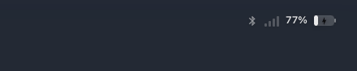 |
| **A timer.** The island holds it while it runs. When the timer ends it swells and says "Done". | 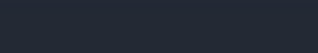 |
| **A device on the desktop.** Earbuds connecting grow a card out of the notch: the photo from `devices.json` (or its kind), the name, "Connected", the battery ring filling. Going, it greys and says where the sound went. A click opens Sound. |  |

### Switching from SDDM

```sh
sudo greeter/install          # greetd + the login screen; SDDM off
sudo greeter/install --undo   # back to SDDM
```

The install script installs greetd and gives it SDDM's PAM stack, so the
GNOME keyring still unlocks at login. It also copies the shell to
`/var/lib/kuwai-greeter`, because greetd's `greeter` user can't read your
home. `greeter/sync` refreshes that copy, with your wallpaper and theme, on
every login (`hypr/kuwai/startup.lua`). Ctrl+Alt+F2 is always a text login.

### Regenerating the previews

```sh
greeter/preview   # ~1 min: redraws everything in docs/media/login
```

It draws the screens in windows inside your session, in a throwaway home
and runtime dir, so nothing is locked, nobody is logged in, and the fake
notifications and timers never touch yours. The stills come from `greeter.qml`'s shot mode.
The GIFs come from `shell/film.qml`, which saves frames with timestamps,
so the GIFs play at real speed. It needs ffmpeg and ImageMagick.

## Clipboard island

Super+V opens it (Super+Shift+V / Super+Alt+V on your pins). cliphist stays
the store; the rice adds copy times, pins (files that outlive the 750-entry
cap) and the island. ↵ pastes into the window you came from, ⌃K lists every
action. Mermaid diagrams draw if mermaid-cli is installed
(`npm i -g @mermaid-js/mermaid-cli`); without it their source shows
highlighted.

## Screenshots of the center

Screenshot pickers work over it: when slurp, hyprpicker, grimblast and the
like take the pointer, the center stays open and takes the keyboard back
after they exit.

## GitHub and Gmail

`bin/rice-feeds` (a user service, `systemd/rice-feeds.service`) turns both
into ordinary notifications, without their apps:

- **GitHub**, through `gh` and its login. It asks once a minute, sending
  If-Modified-Since, so an unchanged inbox costs nothing against the rate
  limit. Review requests, mentions, assignments and failed CI peek out of
  the notch. Comments get a plain toast. Repeated runs of one workflow on
  one branch share a card. Bots (Dependabot, Renovate, their branches' CI)
  go quietly into the center, and your own activity isn't news.
- **Gmail**, over IMAP IDLE: Gmail pushes new mail, so nothing polls. Only
  mail Gmail marks important, in Primary, unread. It needs an app password
  (2-Step Verification on), kept in the keyring: `rice feeds gmail-setup`.

Every card has Open and Mark as Read, and goes away by itself once you've
read it on github.com or in Gmail. `rice feeds` shows the status, `rice feeds
logs` follows it.

## Notifications: adding an app

Apps send inconsistent things. `shell/services/NotifAdapters.qml` has one rule
per app that rewrites the D-Bus notification into what the card should say
(headline, status line + tone, icon, group key, window to focus). Examples:

- **T3 Code** sends `"Thread completed"` + the thread name and no icon. The card
  shows the thread as the headline, a green check status, the T3 icon, merges
  repeats for the same thread (`×2`), and focuses T3 on click.
- **Ghostty** (and Claude Code running in it) sends an empty app name. Matched
  on its desktop-entry hint instead.

Everything else gets the generic rule, with icons resolved from the
notification image → app icon → desktop entry.
