# kuwai

**kuwai** is a desktop environment for Arch Linux made of two halves: a **Hyprland 0.57+** session configured in Lua (`hypr/`) and a **Quickshell** shell (`shell/`) built around a top-edge island. One design system covers every surface — dark liquid glass, Inter with optical sizes (or SF Pro if you have it installed), and critically damped motion ([docs/DESIGN.md](docs/DESIGN.md)).

## A look around

Captured from the shell's rehearsal suite (`bin/kuwai-rehearse --pixels 2`, sample data in an isolated window, shown at their real size) and, for the clips, recorded live at 60 fps on a 2560×1440 laptop screen at 133 % scale, with no pointer and nothing personal on it:

<table>
<tr>
<td>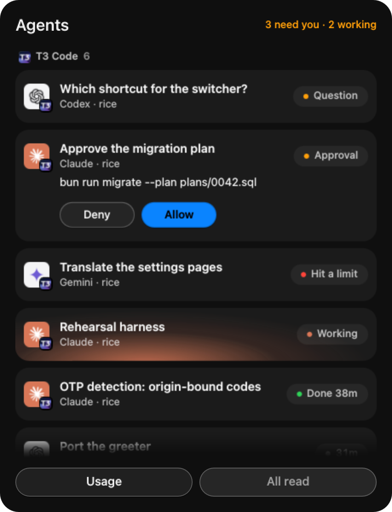</td>
<td>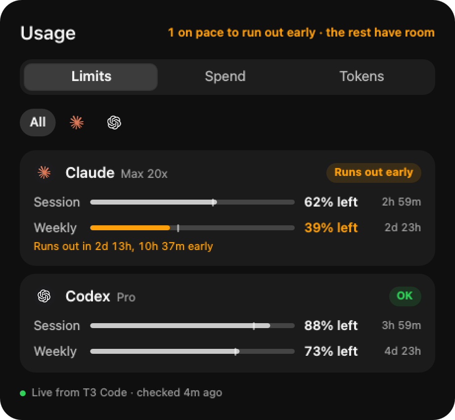</td>
</tr>
<tr>
<td>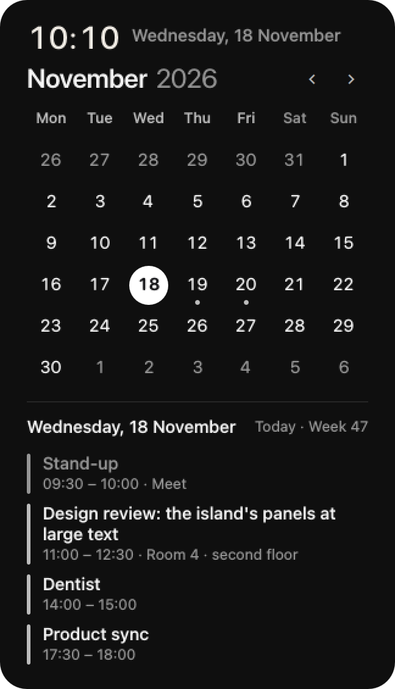</td>
<td>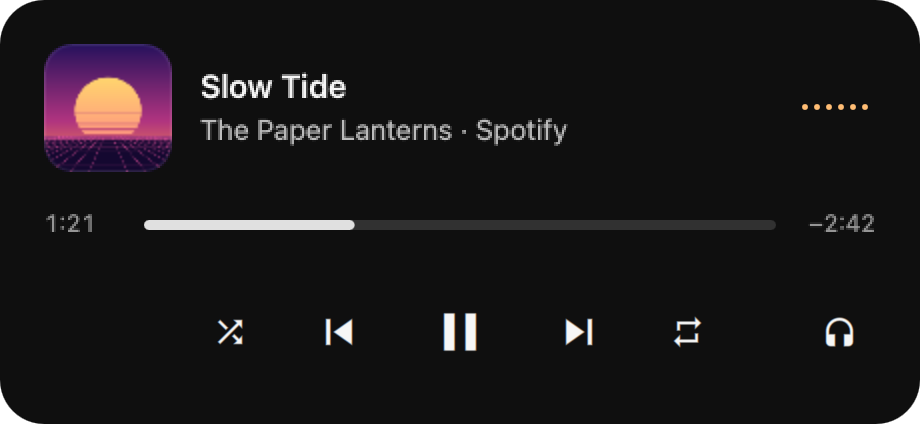</td>
</tr>
<tr>
<td colspan="2" align="center">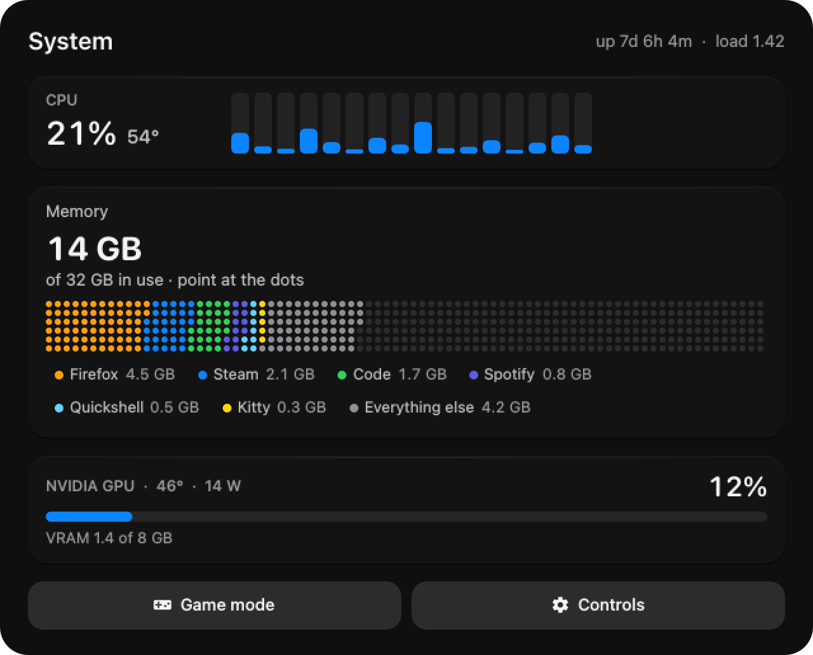</td>
</tr>
<tr>
<td colspan="2" align="center">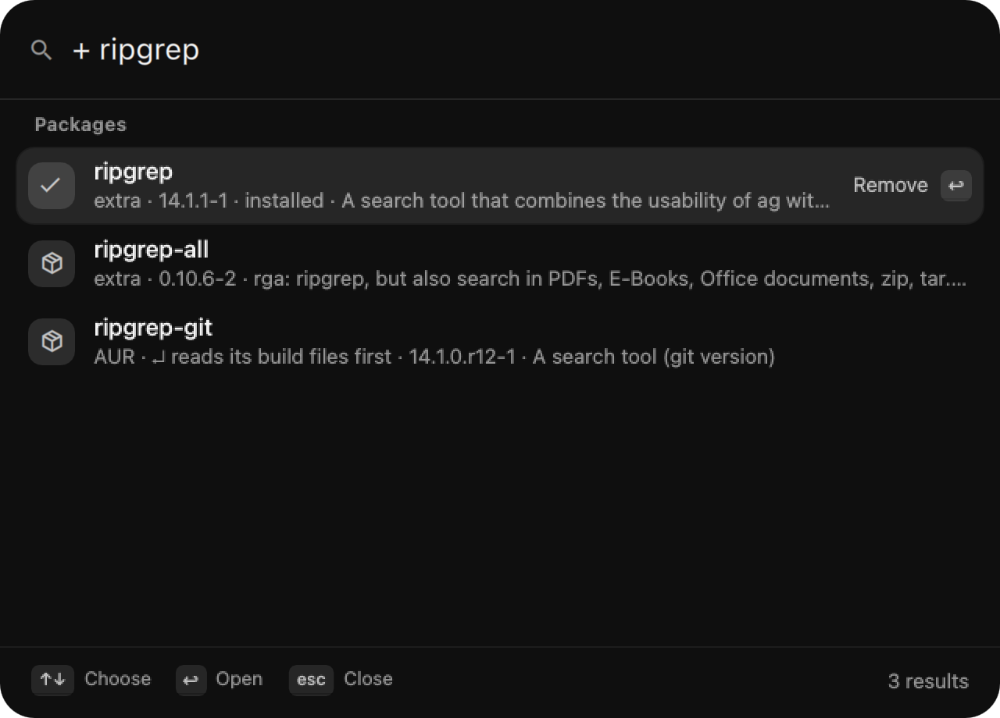</td>
</tr>
<tr>
<td colspan="2" align="center">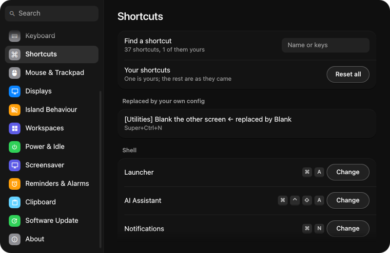</td>
</tr>
<tr>
<td colspan="2" align="center">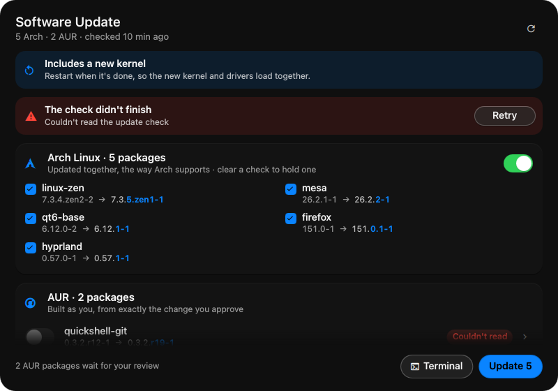</td>
</tr>
</table>

In motion (recorded at 133 %, shown smaller, so every clip stays sharp on any screen):

<table>
<tr>
<td align="center"></td>
</tr>
<tr>
<td align="center">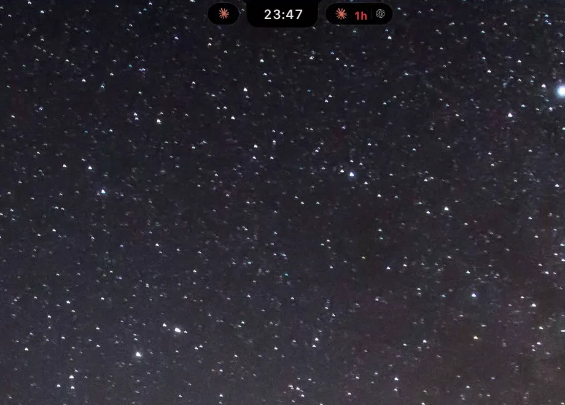</td>
</tr>
<tr>
<td align="center">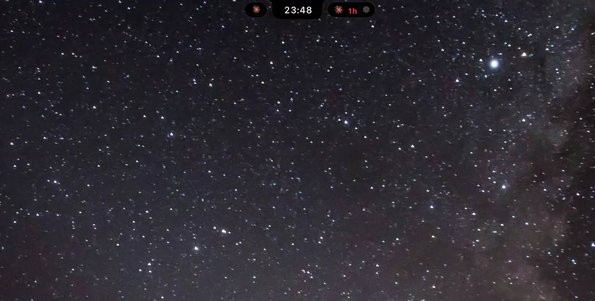</td>
</tr>
<tr>
<td align="center">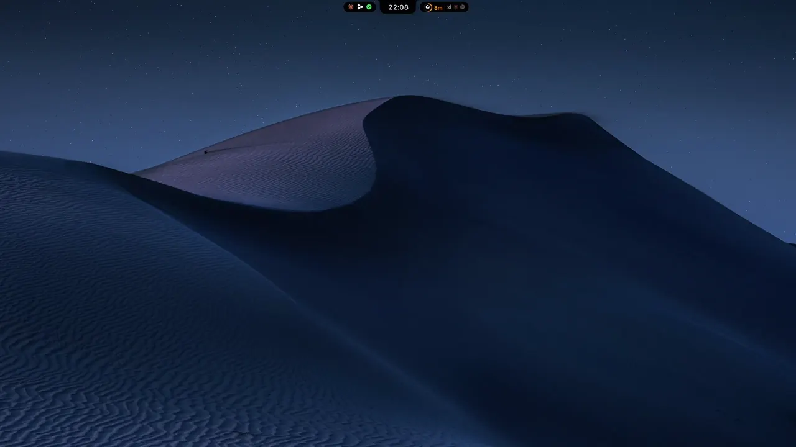</td>
</tr>
<tr>
<td align="center">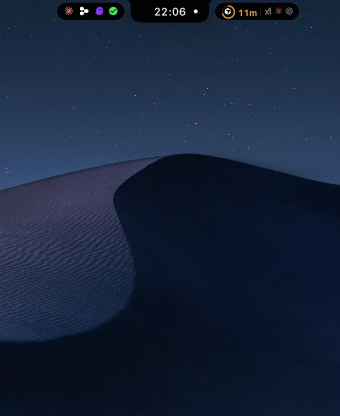</td>
</tr>
<tr>
<td align="center"></td>
</tr>
</table>

## Requirements

- **Arch Linux** with systemd user sessions
- **Hyprland 0.57 or newer** (`install.sh` refuses older versions because kuwai uses Hyprland's Lua configuration)
- **Quickshell** (`quickshell`, `qt6-multimedia`) and core utilities listed in [packages/core.txt](packages/core.txt)
- **Fonts**: `inter-font` (default, SIL OFL) and `ttf-nerd-fonts-symbols` ([packages/fonts.txt](packages/fonts.txt))

Optional packages (screenshot annotation, OCR, live wallpapers, external monitor DDC brightness, Wi-Fi/Bluetooth controls, GitHub/Gmail feeds, dictation, local assistant) are listed in [packages/optional.txt](packages/optional.txt).

## Install

```sh
git clone https://github.com/KitsuneKode/kuwai.git ~/Projects/kuwai
cd ~/Projects/kuwai
./install.sh --dry-run     # preview every change without writing
./install.sh --deps        # install missing Arch packages, stable channel, Hyprland config, user units, and login entry
```

Optional system integrations (require `sudo` and support `--undo`):

```sh
sudo greeter/install       # greetd login screen sharing the lock screen's design (--code refreshes after updates)
sudo system/install        # RTC wake helper so alarms wake a sleeping laptop
kuwai update install-helper # root-owned pacman helper for Software Update
```

kuwai registers its own **Kuwai** login session with Hyprland config in `~/.config/kuwai/hypr/` (`hyprland.lua`, `monitors.lua`, `user.lua`), leaving `~/.config/hypr` and your plain Hyprland session untouched. Everything replaced on first install is recorded in `~/.local/state/kuwai/original/` and restored by `./install.sh --uninstall` (plus `sudo system/session --undo` and `kuwai auth unpin` for the two root-installed pieces).

An AUR `PKGBUILD` and `kuwai-setup` wrapper also live in `packaging/aur/kuwai/`. Full details on channels, migrations, backups, and uninstall are in [docs/manual/install.md](docs/manual/install.md).

## What you get

- **The island** ([docs/manual/island.md](docs/manual/island.md)): Top-edge notch holding workspaces, clock, status, privacy dots (mic, camera, screen share/recording), media, and timers. Background work floats beside it in capsules (agents, waiting approvals, usage limits, system news, minimized windows). Click or pull down to grow a panel.
  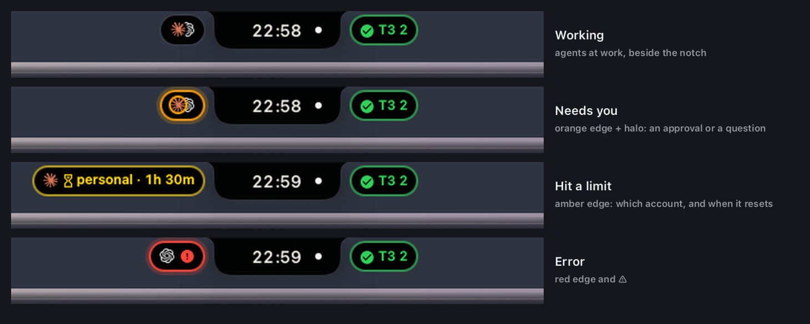
- **Notifications** ([docs/manual/notifications.md](docs/manual/notifications.md)): Built-in `org.freedesktop.Notifications` server with stacked toasts, notch peeks, and a Notification Center (`Super+N`) grouped by app with search and undo clear. Chat bodies stay hidden on passive surfaces and the lock screen; screen sharing hides non-critical bodies everywhere. Optional GitHub (`gh`) and Gmail (IMAP IDLE, keyring app password) feeds are off until enabled.
- **Controls, Sound, and Displays** ([docs/manual/display.md](docs/manual/display.md), [docs/manual/audio.md](docs/manual/audio.md)): `Super+Ctrl+Space` opens Controls (Wi-Fi, Bluetooth, DND, Night Shift, Caffeine, microphone, Reduce Motion, brightness, Display presets, and a per-app PipeWire sound mixer). HDR status reads the live signal on the wire (`bin/kuwai-hdr`).
- **Launcher**: `Super+A` searches apps, open windows, files (`fd`), settings, and actions. Inline prefixes: `=` calculator (math, units, currencies), `!` processes and listening ports (`! 3000`), `+` Arch and AUR packages, `:` emoji, `;` Nerd Font glyphs, plus `timer 10m`, `pomodoro`, `remind me …`, `alarm 7:30`, and `note …`.
- **Clipboard**: Opt-in shelf (`Super+V`, pins on `Super+Shift+V`) backed by `cliphist` with fuzzy search, Quick Look (`Space`), inline editing, OCR (`Ctrl+O`), rendered Markdown/code/Mermaid, secret masking, and undo delete (`Ctrl+Z`).
- **Lock and login**: `Super+L` locks the session; `sudo greeter/install` installs the matching `greetd` login screen. Both use a five-dot pulse password pill (length is never revealed) and hold-to-confirm power actions (0.8 s).
  | | |
  |---|---|
  | 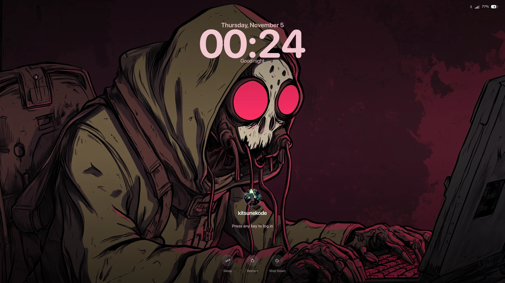 | 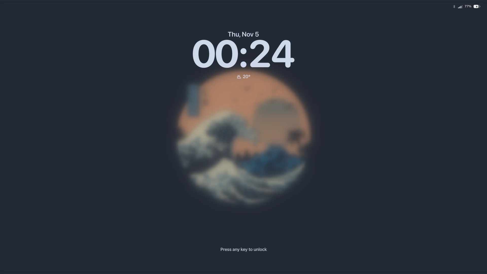 |
- **Themes, wallpapers, and screensavers** ([docs/manual/looks.md](docs/manual/looks.md)): `Super+Shift+T` opens Themes, Wallpapers, Live wallpapers, and Screensavers. `kuwai look` manages 13 dark theme definitions with WCAG 4.5:1 contrast checks, notch-origin wallpaper transitions, GPU-decoded live wallpapers (`kuwai-wall`), and five screensaver modes (`Dusk`, `Borealis`, `Night`, `Live`, `Still`). HyDE is optional.
- **Dictation hooks**: When `voxtype` is installed, `hypr/kuwai/voxtype.lua` binds `F9` (hold to dictate), `Super+Ctrl+D` (toggle), `Super+Shift+D` / `Esc` (cancel), `Super+Ctrl+Alt+D` (recover cancelled take), and `Super+Ctrl+E` (voice edit), and the shell can host voxtype's HUD inside the main process.
- **Agents and usage**: `Super+Shift+N` opens the Agents section (`Alt+1–4` switches Agents, Usage, System, Cleanup). Lists kitty/kittymux panes, T3 Code threads, and agents reporting through `bin/kuwai-agent-hook`. Waiting approvals appear in an orange capsule and can be answered via native hooks (Claude Code/Codex via kittymux `PermissionRequest`, T3 Code via a separate operate token) without typing into terminal panes. Usage tracks per-account rate-limit resets and local log spend.
- **Updates with AUR review** ([docs/manual/updates.md](docs/manual/updates.md)): `Super+Ctrl+Shift+U` opens Software Update. Runs in a detached `kuwai-update` systemd unit, upgrades Arch repo packages together (`pacman -Syu`), requires reviewing AUR `PKGBUILD` diffs before building as your user from the approved git commit, and surfaces `.pacnew` diffs with backups.
- **Cleanup**: Audits unused agent skills (30/90/180 days) and recoverable tool caches (`pip`, `uv`, `npm`, `bun`, `pnpm`, `go`, `yarn`, thumbnails), plus idle project builds when [sweep](https://github.com/KitsuneKode/sweep) is installed. Skills move to the freedesktop Trash with **Put back** restoring their symlinks.
- **Optional local assistant** ([docs/manual/assistant.md](docs/manual/assistant.md)): Off by default (`Settings → Assistant`, `Super+Ctrl+Shift+A`). Connects to a local Ollama server with tool calls, secret redaction on clipboard/selection reads, and confirmation before running commands or opening links.

## Keybindings

Press `Super+/` (or hold `Super`) to open the live shortcuts sheet, or rebind any kuwai action in `Settings → Shortcuts` (`Super+Ctrl+I`). Full reference: [docs/manual/keybindings.md](docs/manual/keybindings.md).

| Keys | Action |
|---|---|
| `Super+A` | Launcher (apps, windows, files, `=` calc, `!` procs/ports, `+` packages) |
| `Super+N` | Notifications center |
| `Super+Ctrl+Space` | Controls (Wi-Fi, Bluetooth, Sound, DND, Display) |
| `Super+V` / `Super+Shift+V` | Clipboard / Clipboard pins |
| `Super+Shift+N` / `Super+Ctrl+A` | Agents panel / Jump to waiting agent |
| `Super+Ctrl+I` | Settings |
| `Super+Shift+T` / `Super+Shift+W` | Themes / Wallpapers |
| `Super+Ctrl+Shift+U` | Software Update |
| `Super+L` / `Super+Backspace` | Lock screen / Power menu |
| `Super+/` | Keyboard shortcuts sheet |
| `Super+Ctrl+Enter` | Answer active island card (notification peek, alarm, reminder) |

## Control, updates, and troubleshooting

Your session runs from the **stable** checkout in `~/.local/share/kuwai` supervised by `kuwai-shell.service`:

```sh
kuwai doctor              # check Hyprland config, notifications, services, and shell health
kuwai status              # systemd status of kuwai-shell.service
kuwai start | stop        # restart or stop the shell (never use killall qs)
kuwai logs                # follow the shell log
kuwai version             # installed version, stable commit, and active channel
kuwai update-self         # update stable to the newest signed release tag and run migrations
kuwai rollback            # return stable to the previous commit and undo its migrations
kuwai demo                # 45-second tour of the island with pretend agents
```

If you develop inside a clone, switch with `kuwai channel dev` and land changes onto stable with `kuwai promote` (which runs `kuwai-check`, backup, `qmllint`, Lua syntax checks, and offscreen load tests, with automatic rollback on failure). Troubleshooting guide: [docs/manual/doctor.md](docs/manual/doctor.md).

## Privacy and security

- **No telemetry.** Settings, notification history, and logs remain local in `~/.config/kuwai`, `~/.local/state/kuwai` (`0700`), and `~/.cache/kuwai` (`0700`).
- **Opt-in collection.** Clipboard history and GitHub/Gmail feeds start off until you accept them during install or enable them with `kuwai collect`. The local Ollama assistant is also off by default.
- **Narrow root boundaries.** Only five components ever use root: `system/session` (login entry), `kuwai auth pin` (root-owned polkit password prompt), `kuwai-update-root` (op-scoped `pkexec` pacman helper), and the optional `greeter/install` and `system/install` helpers.

See [SECURITY.md](SECURITY.md) and [docs/manual/security.md](docs/manual/security.md) for the trust model and known limitations.

## Documentation

- [docs/manual/README.md](docs/manual/README.md) — User manual (install, keybindings, settings, island, notifications, updates, looks, display, audio, assistant, doctor, security)
- [docs/DESIGN.md](docs/DESIGN.md) — Material, typography, colour, motion, and UI primitives
- [docs/ROADMAP-public.md](docs/ROADMAP-public.md) — What is planned after v0.1.0
- [CHANGELOG.md](CHANGELOG.md) — Release history
- [CONTRIBUTING.md](CONTRIBUTING.md) — Development workflow and test gates

## Layout

```text
hypr/         Hyprland 0.57 Lua configuration (see hypr/README.md)
shell/        Quickshell shell (config/, components/, services/, modules/)
shell-auth/   Standalone polkit password prompt (kuwai-auth.service)
shell-saver/  Out-of-process screensaver video player
greeter/      Optional greetd login screen installer and config
system/       Session desktop entry and optional RTC wake helper
bin/          kuwai CLI and helper tools
lib/          Shared libraries (brightness, look palette engine, dispatch, lists)
themes/       13 theme definitions, palettes, wallpaper URLs, and CREDITS.txt
packages/     Arch core, optional, and font package lists
packaging/    AUR PKGBUILD and kuwai-setup wrapper
site/         Static website (Astro)
tests/        Python, Bun, Lua, and UI rehearsal test suites
```

## Licence and credits

kuwai is free software under the **GNU General Public License v3.0 or later** ([LICENSE](LICENSE)).

Third-party wallpapers are **not** shipped in this repository; `kuwai-theme install` downloads them directly to your machine with checksum verification and credits every photographer, artist, and licence in `themes/*/CREDITS.txt`. Third-party icon sets, glyph databases, and brand marks keep their own terms ([NOTICE.md](NOTICE.md)).
