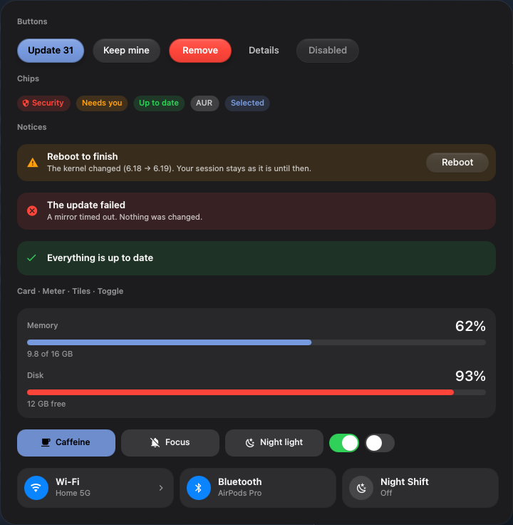
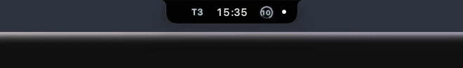

# Design

The foundation is the glass HUD (first built as `~/.config/quickshell/glass-osd`).
Every new surface should feel like it came from the same hand. Tokens live in
`shell/config/Theme.qml`; use them instead of literals.

## Material: liquid glass

Hyprland does the blur, the surface draws the material (`components/GlassCard.qml`):

- **Tint:** near-black `#111114` at 58% alpha (`Theme.glassTint`; denser steps
  `glassTintThick` 68%, `glassTintElevated` 74%, `glassIsland` 84%), so text
  stays readable while the blur reads through.
- **Sheen & rim (single-pass SDF):** `GlassCard` draws the base tint, 1px
  outer dark ring, top-down sheen, bottom shade, directional specular rim
  (brightest top-left, softer bounce bottom-right), and optional procedural
  grain in one `ShaderEffect` pass (`shaders/glasscard.frag`).
- **Hyprland side:** every surface is a layer named `kuwai-*`, with blur,
  `ignore_alpha 0.3` (blur only under the card, not the clear margins),
  `xray 0` (blur real windows), and `no_anim` (the surface animates itself).
  This is all in `hypr/kuwai/rules.lua` already; just name new layers `kuwai-<thing>`.

## Type

One face, resolved once when the shell starts (`Theme.fontKind`, from
`Qt.fontFamilies()`), always through `components/Label.qml`:

- **Inter** is the default: OFL, `inter-font` in Arch's official repos, so
  anyone can install it (`install.sh --deps` does). It has optical sizes like
  SF Pro: the static `Inter` + `Inter Display` pair (Text below 20 px,
  Display from 20 px), or the variable font's `opsz` axis (14–32), which
  `Theme.axesFor(px)` sets at three steps (14 · 22 · 32) when there is no
  Display cut. Its spacing is designed into each optical size, so **no
  tracking table** is applied. It has no rounded cut: numerals that SF Pro
  sets in Rounded take Inter's open digits (`ss01`) instead.
- **SF Pro**, when installed, is used instead (an upgrade, never shipped:
  Apple's licence limits it to Apple platforms). Static Text below 20 px,
  Display from 20 px. Weights are Apple's: 400 / 510 / 590 / 700 (Inter
  takes its nearest instances).
- **Tracking is Apple's, for SF Pro only**, read from its `trak` tables
  (`Theme.tracking(px, rounded)`): e.g. 11px +0.06, 13px −0.08, 14px −0.15,
  15px −0.23, 20px −0.45, 28px +0.38. macOS applies it automatically; Qt
  doesn't, so we do. Measured for SF Pro, so never applied to another face.
- **SF Pro Rounded** for numerals beside SF Pro (`Label { rounded: true }`):
  count badges, the HUD's level and battery. Apple's widget / Control
  Center habit.
- Neither installed: fontconfig's sans-serif, with no tracking and no
  features. `KUWAI_FONT=inter|sf|system` picks one of the installed three.
- Changing numbers use tabular figures (`Theme.numeralFeatures(rounded,
  true)` keeps Inter's open digits too) and a fixed width.
- Not used: SF Compact (watchOS), New York (serif).
- Sizes are decimal, as GNOME and macOS print them (1 kB is 1000 B, 1 GB is
  1000 MB), from one formatter, `shell/services/sizes.mjs`. A file that
  divides a size by 1024 or 1e9 fails `tests/shell/sizes.test.mjs`.
- No uppercase or letter-spaced labels; hierarchy from size and weight.
- Over glass, text is brighter than on a solid surface: .96 / .72 / .50.
- Hyprland's own text (group bars, its error bar) asks Pango for
  "SF Pro Text, Inter, sans-serif" (`hypr/kuwai/look.lua`).
- The voxtype HUD style (`~/.config/voxtype/osd/kitsune-hud`) is the
  author's own and is set in SF Pro.

## Colour and severity

Apple's dark-mode system colours: `Theme.red #ff453a · orange #ff9f0a ·
yellow #ffd60a · green #30d158 · blue #0a84ff`.

Severity changes the material, not just one word's colour:

| Level | From | Look | Behaviour |
|---|---|---|---|
| critical | D-Bus urgency Critical | red wash + edge, `CRITICAL` chip, icon badge, one glow ring on arrival, first action filled red | sound, stays until dismissed, top of the stack, breaks through DND |
| warning | adapter, or wording ("failed", "battery low", …) | orange wash + edge, `WARNING` chip, icon badge | 9 s |
| normal | default | thick glass (`glassTintThick`) | 5.5 s |
| low | urgency Low | lighter glass, one body line | 3.5 s |

## Motion

Three sources, one rule set: Apple's fluid-interface talks, Fluid
Functionalism (springs), Emil Kowalski (curves, gates).

**Gate first.** Motion only where it has a job: showing where something
came from (the centre sliding in from the edge it lives on), state changes,
feedback. Things you hit tens of times a day stay near-imperceptible (rows:
press 0.985, the HUD: 180ms, 6px).

**Springs** (`components/Spring.qml`, interruptible, keeps velocity on retarget):
`Theme.springFast` 0.08s (highlights, fades), `springModerate` 0.16s
critically damped (tabs, things that must land exactly), `springSlow` 0.24s
bounce 0.12 (large surfaces, morphs). Exits are tweens one tier quicker.

**Curves** (`Theme.easeOut` 0.23,1,0.32,1 · `easeInOut` 0.77,0,0.175,1 ·
`easeDrawer` 0.32,0.72,0,1). Never ease-in on UI. UI stays under 300ms:
press 140, enter 200, exit 150, glide 150, reflow 200, HUD 180/150.

**The centre is an island panel** (the phone's model): Notifications is
pulled down from the island, Controls and Sound from its right side. With the
island as a notch or a floating pill it is one of the island's panels
(`island/CenterPanel`): the island's black, its radius, its open and close
springs (surfaceIn, surfaceKeyIn from a key), its origin, panelS wide. Its
header is the panels' own: the title left (tTitle3 semibold), what acts on it
right (Do Not Disturb, Clear, or Undo after a clear), and where there are
tabs, the island's section chips (`components/SectionChips`, the same ones
Agents, Usage, System and Cleanup switch with). With Waybar it is a 420px
glass card at the right corner instead, over a `kuwai.scrim` backdrop, with
the same content. Motion starts only once Hyprland has mapped the surface.

**Text renders with FreeType** (`renderType: Text.NativeRendering` in Label):
Qt's distance-field atlas drew some labels blank or overlapped with a
variable font at many weight/size combinations.

**Fluid hover** (`components/FluidHighlight.qml`): one highlight per list
gliding on the fast spring; fades in fresh where the pointer lands; doubles
as the keyboard ring.

**Press feedback**: scale 0.97 (rows 0.985), 140ms ease-out, on pointer-down.

**Reduced motion**: `KUWAI_REDUCE_MOTION=1`, or automatically when Hyprland's
animations are off. Fades and colour stay; travel, scale, glides and the
morph go.

**Performance**: transform/opacity where possible; the glass rim (a CPU
Canvas) shows a plain edge while its size is moving and repaints once at
rest; surfaces exist only while visible (nothing invisible sits over the screen).

Rules kept from before:
- Animate from the current value, so a retrigger mid-exit turns around instead of restarting.
- Leave the way you came: the HUD drops from the bar and goes back up, toasts
  enter from the bar and leave the same way.
- Updates in place get a small pulse (scale 1.02), not a new entrance.
- At a boundary, rubber-band (the brightness track stretches 3.5%).
- Arrivals that matter get one cue, never a loop.

## Toast stack (Sonner)

Ported from Sonner's source (`refs/emilkowalski_sonner/src`), tokens in Theme:
3 visible, 14px gap, each one behind 5% smaller and cut to the front one's
height with its content hidden; hover fans them out to full height and pauses
every timer (they resume, not restart). 400ms CSS `ease` on y/scale/opacity/
height, starting from the current value. Enter drops from one card-height
above; the front exits back up, a fanned-out one exits up from its slot, a
collapsed one behind sinks 40% (500ms, opacity 200ms); unmount after 200ms.
Swipe locks its axis on the first pixel, follows 1:1 away from the corner
(right/up), damps the other way by `1/(1.5+|d|/20)`, dismisses past 45px or
0.11px/ms averaged over the gesture, with a 200ms ease-out throw.

## Notification centre

An island panel (above), grouped by app; each group folds into a
stack (newest on top, two plates peeking out below). Opening focuses search.
Words must all match (app, title, body, status) and matches highlight in
yellow. Filters: All / Unread / Important, chips like Usage's (a platter under the one
chosen), Unread and Important with their counts. Keyboard: ↑↓ select (blue ring),
↵ open, Del or ⌫-on-empty dismiss, →← expand/fold, Tab filter, Esc clears then
closes. Searching snaps results instantly (no choreography between keys).
Closing marks everything seen: blue dots and the bell's count clear.
Clearing (a row, an app's group, or all; the island's list too) can be
undone: "Cleared N · Undo" takes Clear's place for `Theme.undoMs`, and Ctrl+Z
there does the same. The items leave the list and the history file at once
and come back where they stood, a toast only as its row; one-time codes are
never kept for it (`services/notifUndo.mjs`).

## Interaction

- Feedback surfaces (HUD) are click-through.
- Toasts: click acts (default action, then focus the app's window), right
  click, the hover close button or a swipe right dismisses.
- Every surface gets an IPC entry (`bin/kuwai …`) so it can be bound to keys.

## Primitives (`components/ui`)

One primitive per job: no panel draws its own button, chip, card or notice.
Import `qs.components.ui`; build only from `Theme` tokens (surfaces
`card`/`cardEdge`, tints `tintChip`/`tintNotice`, radii `r1`–`r4` = 8/12/16/22,
space `s1`–`s5` = 4/8/12/16/24). See them all: `qs ipc -p <shell> call test
gallery on` (no keyboard taken), `off` to close.

| Primitive | Use it for | Don't |
| --- | --- | --- |
| `Button` | `primary` (the one thing to do; at most one per view), `secondary`, `danger` (destroys something; still asks), `quiet` (the third action: "Details", "Later"). Quiet with only a `glyph` is an icon button (`label` names it, shown as its tip; `busy` turns the glyph); a quiet `tone` colours its mark (a flag's orange) | Two primaries side by side; danger for "Cancel"; a hand-drawn round glyph button |
| `Chip` | A state, a kind or a count next to a title ("Security", "AUR") | Making it clickable (use a Button) |
| `ContextMenu` (+ `ContextMenuItem`, `ContextMenuCheckboxItem`, `ContextMenuLabel`, `ContextMenuSeparator`) | What a row offers, by right-click or Menu / Shift+F10 on the focused row (shadcn's anatomy). Show the key a row already answers to as `shortcut`; `variant: "destructive"` for what can't be taken back | The only way to reach an action (a menu repeats what the row or panel already offers); a menu on empty panel ground (right-click there goes back) |
| `Notice` | Something to know inside a panel, in its tone: orange needs you, red broke, green done; one action at most | Stacking three; using it for a toast (that's Notifs) |
| `Card` | Grouping related rows inside a panel; children stack 10 px apart, 14 px in | Cards inside cards |
| `Meter` | A level with its number (memory, disk, GPU): accent, orange > 75 %, red > 90 % | A meter for things that aren't levels |
| `Tile` | Quick on/off for a mode (Caffeine, Focus), Control Center style: accent while on | A settings row (use `Toggle`) |
| `ControlTile` | The Control Center grid (Wi‑Fi, Bluetooth, Night Shift): disc in its tone while on, a status line; expandable ones open more from the right half | Small rows of modes (use `Tile`) |
| `Toggle` (`components/`) | A setting's on/off in a row: green while on, like iOS | A mode tile |
| `Segmented`, `Slider`, `Tip`, `KeyCap`, `FocusRing` (`components/`) | Tabs, one choice of a few ("Keep mine · Use new"), levels you drag, hover help, key hints, keyboard focus | Re-drawing any of them in a panel |
| `ScrollFade` + `ScrollHint` (`components/`) | Every list that scrolls gets both: rows fade where more lies, a thumb shows while it moves (`inside: true` for a list in a Column) | Binding either one's `visible` (each follows its list) |

States every pressable primitive has: hover (a wash, `colorMs`), press
(scale 0.97, `pressMs`), disabled (tertiary ink, no press), keyboard focus
(`FocusRing`, Tab reaches it, Space/Enter presses), a screen-reader role and
name.

## Cards that grow out of the island

Things that ask for an answer grow out of the island the way an iPhone's
alarm does (`modules/island/AlarmCard.qml`): an alarm ringing (Snooze ·
Stop ✕, until answered, 5 min at most), a reminder due (Later · Done ✓, 30 s,
then the centre), a timer done (Repeat · Done). The mark is in its tone
(orange asks, green is done); the bell swings like a hung bell and a ring of
light breathes out of it while an alarm rings; a reminder's ring fills once.
The text rises 4 px in order, the answers last. Reduced motion: none of it
moves. A device connecting never pushes one aside. Locked, the lock island
has the same answers.

## Dictation (the island hosts it)

A take lives in the island, like a live activity on a phone, and its words are
said in one place only. `services/Dictation.qml` reads the take (logic in
`services/dictation.mjs`), `island/DictationMark` is its two sides,
`island/DictationWords` the words under them, `island/DictationPanel` the
expanded view. Settings → Dictation words: `island` (the default) hides
shuush's pill at the bottom of the screen (VoxtypeHost suppresses its surface;
KitsuneHud's own `island` style stays hidden while this shell is alive).

- **Stage:** dictation outranks everything but a password prompt, a moment
  included; a running meeting keeps its small mark (● 12:04) beside it; music
  steps into its capsule. A notification that isn't critical waits until the
  take is written (`Notifs.peekWaits`), then peeks as usual.
- **States:** listening (a breathing red dot, five bars from the mic, the clock,
  where it goes: "0:12 T3 Code"); too quiet (orange, three seconds without a
  word); mic muted or sending nothing (a crossed mic); writing (the bars turn
  accent and a light runs through them, "Writing into Kitty"); then the ending,
  held long enough to read: Typed into Kitty ✓, Copied · paste it, Kept · the
  window changed (click to bring it back, `shuush recover`), Private · not
  typed, Cancelled · nothing typed, Didn’t hear anything, one plain sentence
  for a failure. More takes waiting: a small `+1`. Voxtype keeping the mic warm
  after a take: a hollow dot among the privacy dots.
- **Words, never twice:** where the field shows the live words (the fork's
  preedit, `live_in_field`, latched for the whole take) the island shows none.
  Where it can't (terminals, apps without an input method) the island grows down
  into the words, the newest two lines sliding up, then the first line of what
  was typed. A private field (`sensitive_field`, `pp_private`) or a shared
  screen: no words, ever. The ring stays around the target window; its caption
  is gone.
- **Expanded:** click the activity: the full text so far, Cancel and Finish,
  Bring back for a kept take. It never takes the keyboard (`Island.keyless`):
  the words are going into the window you were in. Right-click cancels; Esc
  cancels as before.
- **Reduced motion:** the dot stops breathing, the bars hold a still shape, the
  words don't slide; colour and words still change.

## Meetings (voxtype's meeting mode)

kuwai is voxtype's meeting view host (`services/Meeting.qml`, logic in
`services/meeting.mjs`). Settings → Island Behaviour → Meetings turns it off,
and voxtype's own meeting window comes back.

- **Nothing runs at rest.** The daemon's `meeting_state` file and its runtime
  folder are watched; a reader (`setpriv --pdeathsig KILL -- voxtype meeting
  watch --json --levels`) runs only while a meeting does, and lets go once it
  has ended and its summary has arrived (or 10 minutes later).
- **The live activity** (`island/MeetingMark`): a red dot that breathes, the
  elapsed time, four level bars, and the latest line ("Dana: …", plain text,
  cut to the island's room). Paused: orange pause bars, the bars stop.
  Click: the panel. Right-click: pause or resume.
- **Dictation and a meeting at once:** dictation has the stage (it is what you
  are doing this second); the meeting keeps a small mark (● 12:04) beside the
  status, and the panel says the meeting hears your dictation too. Music steps
  into its capsule for a meeting as it does for dictation.
- **Privacy:** the orange mic dot shows for the whole meeting, paused too; over
  a fullscreen window a single dot (`island/PrivacyOverFilm`, layer
  `kuwai.privacy`, click-through) sits in the top-right corner. While the
  screen is shared, transcript lines are hidden in the island and the panel.
- **The panel** (`island/MeetingPanel`): Now (status, Pause/Resume, Stop, the
  two meters, the consent notice word for word with OK, speakers, the summary
  and action items, the transcript following its end) and Meetings (past ones;
  a meeting opens with Copy, Save as Markdown into Documents/Meetings, and
  Delete, which takes two presses).
- **Offers, never recording:** a calendar event with a call link, from a
  minute before its start to five after, or a call app holding the mic for six
  seconds (`voxtype meeting suggest --dry-run`, only when the daemon doesn't
  prompt itself) brings an alarm-style card: the title, "Record this
  meeting?", Not now · Record. Once per event or call
  (`~/.local/state/kuwai/meeting-offers.json`); never while meetings are off.

Taken from Hex (anomalyco/hex, MIT; ideas only): the offer's words and its
two answers ("Q4 sync detected" · Not now · Record), the newest transcript line
beside the timer in the live capsule rather than a separate window, the
timer in tabular figures after a status dot, a destructive action that takes a
second press, and "Copied" said by the button itself instead of a
toast. Left out: Hex's always-dark dot-scope HUD (the island already is that
surface) and its separate history window (the panel's Meetings section is it).
