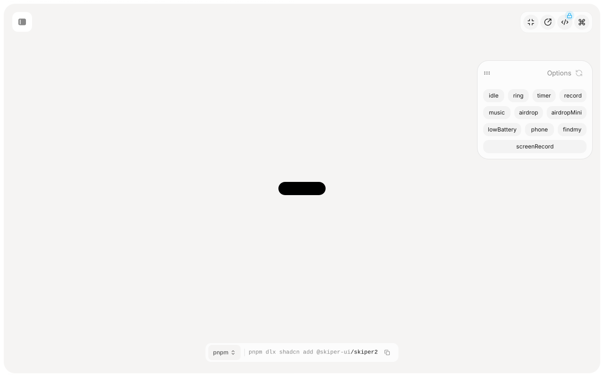
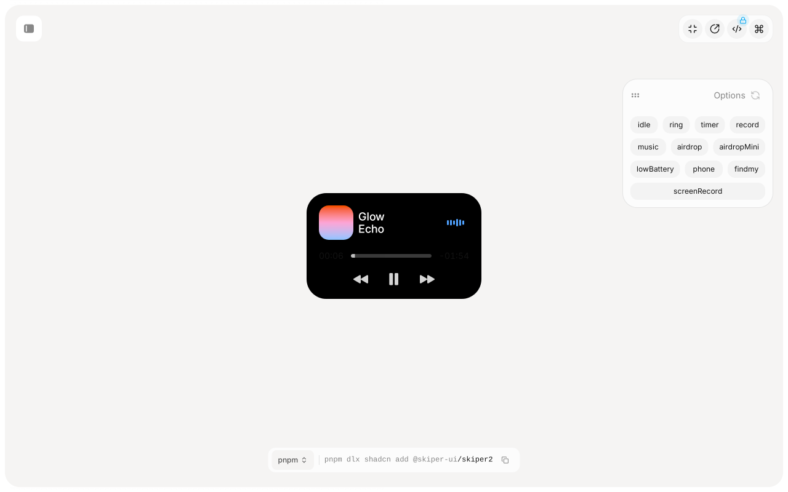
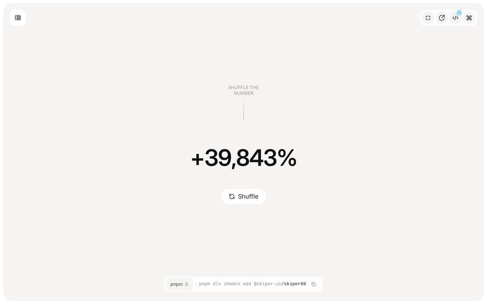
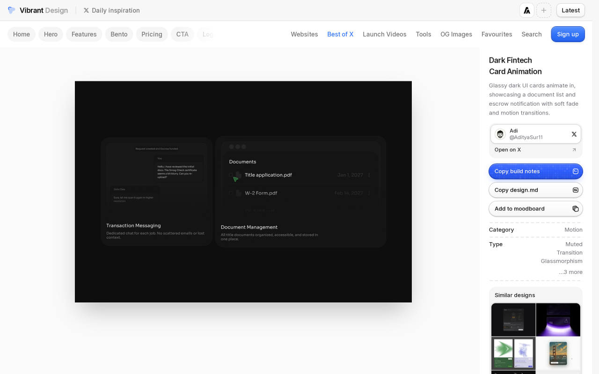
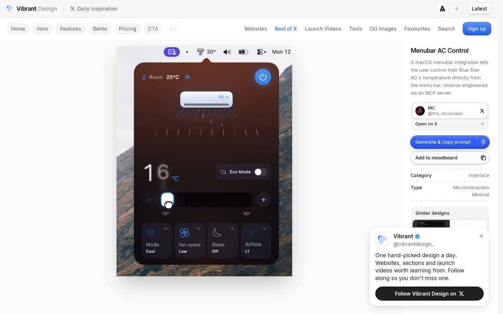
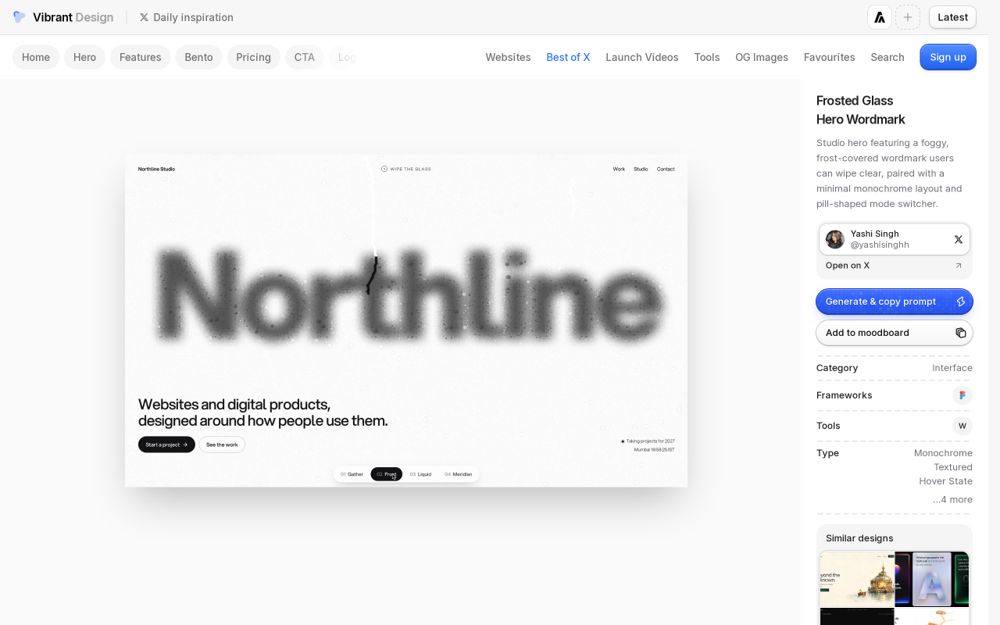
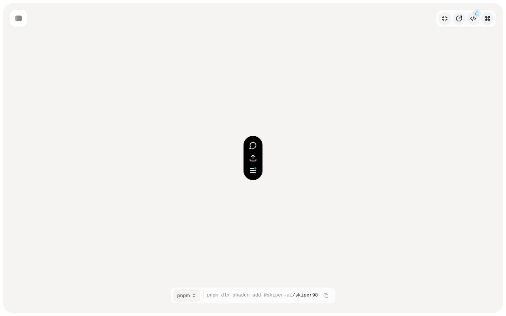

# kuwai design scout — vibrant.design + skiper-ui.com

Research date: 2026-11-05. Browser: 1280×800, light scheme on skiper-ui; vibrant feed pages on `rgb(247, 247, 248)` canvas. No source code was read; values below are from live DOM/CSS unless noted as feed copy only (video demos).

Screenshots (repo-relative):

| File | Source |
|------|--------|
| `vibrant-home.png` | https://vibrant.design/ gallery |
| `vibrant-liquid-glass.png` | https://vibrant.design/feed/gmqabxs-liquid-glass-card-grid |
| `vibrant-menubar-ac.png` | https://vibrant.design/feed/rzjn1ku-menubar-ac-control |
| `vibrant-frosted-wordmark.png` | https://vibrant.design/feed/0itwwkz-frosted-glass-hero-wordmark |
| `vibrant-dark-fintech.png` | https://vibrant.design/feed/241298m-dark-fintech-card-animation |
| `skiper-dynamic-island-idle.png` | https://skiper-ui.com/v1/skiper2 |
| `skiper-dynamic-island-music.png` | https://skiper-ui.com/v1/skiper2 (music state) |
| `skiper-number-flow.png` | https://skiper-ui.com/v1/skiper69 |
| `skiper-vertical-tooltip-menu.png` | https://skiper-ui.com/v1/skiper98 |

**Site gaps:** vibrant.design text search returned few direct “Dynamic Island” hits; most relevant entries surfaced via homepage scroll. skiper-ui has no dedicated toast/Sonner page in the public sidebar (checked ~101 component names); notification patterns were inferred from Dynamic Island states, tooltip menus, and vibrant feed copy.

---

## Ranked shortlist (steal list)

### 1. Percentage border-radius morph on a single black capsule (Skiper Dynamic Island)

- **Source:** https://skiper-ui.com/v1/skiper2  
- **Maps to:** rest notch, live activity, hover panel, toast/peek (compact ⇄ expanded), media row in panel.  
- **Why premium:** One continuous shape grows/shrinks instead of swapping boxed cards; reads as hardware-adjacent like iOS Live Activities.  
- **Observed values (computed after state button clicks, ~1s settle):**
  - **idle:** 100×28 px, `background: rgb(0,0,0)`, inline `border-radius: 32px` (full pill for 28 px height).
  - **lowBattery / phone (compact live):** 222×28 px, `border-radius: 14.4264% / 114.246%`, `transform: scale(1.00825, 1.00035)`.
  - **airdropMini:** 287×73 px, `border-radius: 11.1605% / 44.0457%`, `scale(1.0096, 1.00905)`.
  - **screenRecord:** 291×81 px, `border-radius: 11.0034% / 39.6177%`.
  - **music (panel-like):** 287×174 px, `border-radius: 11.1582% / 18.3745%`; title glyph **Echo** at 18 px / weight 500 / `rgb(255,255,255)` / line-height 20 px.
  - Demo chrome: option chips `12 px` type, padding `6px 10px`, radius `12px`, fill `rgb(243,243,243)`.
- **QML note:** Drive one `Rectangle` (or `Item` + layer) with animated `width`, `height`, and **asymmetric** `radius` (Qt supports per-corner; approximate iOS by binding x/y radii to `height*0.44` and `width*0.11` in expanded states). Use `Behavior on width/height/radius` with `SpringAnimation` (high damping ~1.0, low bounce) for layout; apply subtle `scale` 1.0→1.01 only on **user flick** (velocity threshold), not idle. Clip children with same radius; cross-fade content with `OpacityAnimator` 120–180 ms `OutCubic`.

 

---

### 2. Fixed 28 px “live activity bar” height with horizontal stretch only

- **Source:** https://skiper-ui.com/v1/skiper2 (`lowBattery`, `phone` states)  
- **Maps to:** rest marks, live activity wordmark (“T3 · 3 active”), compact notification peek.  
- **Why premium:** Keeps the notch silhouette stable; motion reads as status, not layout jump. Calmer than height-changing toasts.  
- **Observed:** Width 222 px at 28 px height; pill ends via `% / %` radius (above); no padding on shell (`padding: 0`).  
- **QML note:** `states: [ State { name: "compactLive"; PropertyChanges { target: island; height: 28 } } ]`. Animate **only** `width` + `contentItem.x` with shared `SpringAnimation`. Marks as `Row` with `spacing: 6`, `Layout.preferredHeight: 28`, no per-mark `Rectangle` backgrounds.

---

### 3. Tabular digit counter styling (Skiper Number flow)

- **Source:** https://skiper-ui.com/v1/skiper69  
- **Maps to:** update count mark, OSD numeric labels, lock screen time adjuncts.  
- **Why premium:** Rolling digits feel intentional at small sizes; avoids jittery width when count goes 9→10.  
- **Observed:** Main digits **60 px / weight 600 / letter-spacing -1.5 px / color rgb(18,18,18)** (demo is large; scale down). Caption digits **12 px / weight 500 / rgba(0,0,0,0.5)**. Per-digit boxes ~35–37×60 px; `transition: all` on spans (implementation uses vertical roll in DOM).  
- **QML note:** For 11–13 px marks, use `Text { font.family: SF Pro; font.features: ["tnum"]; }` in a clipped `Item` height = one line; animate `y` or `NumberAnimation` on a `ListModel` of digits. Prefer **opacity cross-fade** for 1-digit counts; full roll only when value changes while island is visible.

---

### 4. Dark glass stack for notification content (vibrant feed — Dark Fintech Card Animation)

- **Source:** https://vibrant.design/feed/241298m-dark-fintech-card-animation (video; copy only for motion)  
- **Maps to:** toast/peek, bell quick-list rows, hover panel sections.  
- **Why premium:** Feed describes “glassy dark UI cards” with “escrow **notification**” and soft fade — aligns with near-black glass without rainbow chrome.  
- **Observed:** Page body `rgb(247,247,248)`; demo content in `<video>` (no iframe DOM). Description text only; visually (frame grab): dark translucent cards, soft edge light, no hard 1 px boxes on every row.  
- **QML note:** One `Rectangle` per toast with `color: #000000` at ~88% opacity + `FastBlur` via `layer.effect` (radius modest, 24–32). **Single** container; rows are `Column` spacing 8, no nested bordered boxes. Enter: `opacity` 0→1 220 ms `OutCubic`; exit: 180 ms `InCubic`.

---

### 5. Menubar-integrated compact control (vibrant — Menubar AC Control)

- **Source:** https://vibrant.design/feed/rzjn1ku-menubar-ac-control  
- **Maps to:** rest notch metaphor, OSD (volume/brightness), popover anchor.  
- **Why premium:** Shows status + control in one top strip without modal chrome — same family as kuwai island.  
- **Observed:** Feed copy: macOS menubar temperature control via MCP; video `1080p` on CDN. Layout (video): slim top bar, dropdown panel aligned to bar center, dark fill.  
- **QML note:** Treat hover panel as `Popup`/`PanelWindow` anchored to island bottom center; match island width animation so panel feels grown from notch, not a separate `Window` with different radius.

---

### 6. Tooltip delay policy — “delay once, then instant” (vibrant)

- **Source:** https://vibrant.design/feed/7jsg6r2-tooltip-hover-delay-comparison  
- **Maps to:** bell popover, hover panel affordances, mark hovers.  
- **Why premium:** Reduces accidental flicker and nervous UI; second hover within session feels “fluent”.  
- **Observed:** Feed copy only (side-by-side video); no DOM timings exposed. Industry-typical pairing to test: **400 ms** first show, **0 ms** within 2 s of last hide (validate in implementation).  
- **QML note:** `HoverHandler` + `Timer` `interval: 400`; set `instantTooltips` flag for 2000 ms after close. Do not animate tooltip scale; fade 120 ms max.

---

### 7. Frosted wordmark + pill mode switch (vibrant)

- **Source:** https://vibrant.design/feed/0itwwkz-frosted-glass-hero-wordmark  
- **Maps to:** lock screen, screensaver, island glass language.  
- **Why premium:** Monochrome + frost reads luxury; pill switcher is a single control, not a row of boxes.  
- **Observed:** Copy: “foggy, frost-covered wordmark”, “minimal monochrome layout and **pill-shaped mode switcher**”. Video demo.  
- **QML note:** Prefer `MultiEffect` blur on a static noise layer behind text; pill switcher ~28–32 px tall, radius 16 px (kuwai 16 step), two segments without outer border — selected segment `rgba(255,255,255,0.12)`.

---

### 8. Inline toolbar labels without enclosing chips (Skiper Vercel Tooltip demo)

- **Source:** https://skiper-ui.com/v1/skiper43  
- **Maps to:** rest marks, hover panel tabs, notification actions.  
- **Why premium:** Directly addresses “too many boxes” — labels sit on continuous black (`rgb(0,0,0)`) bar.  
- **Observed:** Toolbar cluster **505×32 px**, items **Comment ~107×32**, **Inbox ~51×32**, **Feature Flags ~101×32**; text **16 px**, `rgb(255,255,255)`, **0 px radius**, transparent item backgrounds.  
- **QML note:** Replace mark `Rectangle` wrappers with `Row` of `Text` + optional 6 px dot; hit target via `TapHandler` on invisible `Item` padding 8 px vertical. Selected mark: weight 500 + full opacity; idle marks opacity 0.45.

---

### 9. Vertical black action stack (Skiper Vertical tooltip menu)

- **Source:** https://skiper-ui.com/v1/skiper98  
- **Maps to:** bell quick-list popover, peek actions.  
- **Why premium:** High contrast, no shadow soup; reads as extension of island.  
- **Observed:** Stack **107×96 px**, `background: rgb(0,0,0)`, **0 px radius** on panel; circular trigger **48×112** hit area with `border-radius: 1.67772e+07px` (full). Labels include shortcut hints (“C”, “K”).  
- **QML note:** Popover `radius: 12` (kuwai) softens skiper’s square stack; keep **one** fill. `Column` spacing 4; shortcut in `Text` 11 px opacity 0.35.

---

### 10. Subtle glass play control (Skiper Apple play button)

- **Source:** https://skiper-ui.com/v1/skiper3  
- **Maps to:** hover panel media, island media mark.  
- **Why premium:** 60 px circle, fill `oklab(0.182203 … / 0.2)` ≈ 20% near-black glass — color only for state, not decorative gradient.  
- **Observed:** Control **60×60 px**, `border-radius: 9999px`, no box-shadow, `transition: all`.  
- **QML note:** `Rectangle { radius: 30; color: "#000000"; opacity: 0.2 }` + icon; on play state animate to opacity 0.35 over 150 ms.

---

## Don't copy

| Pattern | Source | Why avoid |
|---------|--------|-----------|
| WebGL “liquid” glass + FLIP reorder | vibrant Liquid Glass Card Grid | GPU cost, visual noise vs calm shell |
| Iridescent bubble reflections | vibrant Bubble Glass UI | Breaks near-black, reads toy-like |
| Multicolor wallet cards | skiper Minimal Card Expand (`oklch` purple/cyan fills, 24 px radius) | Conflicts with “colour only for state” |
| 256 px hero digits | skiper Animated number | Absurd scale for 28 px notch |
| Sky-blue active nav (`oklch(0.685 0.169 237.323)`) | skiper chrome | Off-brand vs kuwai neutral |
| Constant `scale(1.009…)` on idle island | skiper2 inline styles | Reads as breathing gimmick; use only on gesture |
| Bold orange full-screen action moment | vibrant Action Button Concept | Loud; breaks calm lock/screensaver |
| Gooey / Nike elastic menus | skiper13 / skiper46 | Overshoot everywhere fights damped springs |
| Elemental glow / fiery gradient cards | vibrant homepage feed | Premium ≠ saturated motion backgrounds |
| Separate boxed mark for every stat | kuwai feedback target | Reinforces “too many boxes” |

---

## Three concrete rest-notch proposals (time + marks)

### A — Single-line typographic strip (“no boxes”)

- **Layout:** One capsule **height 28 px**, `radius 14 px`, fill `#000000` (no border). Horizontal padding **12 px**. `Row` spacing **10 px**: time **15 px / weight 590 / `#FFFFFF` / letter-spacing -0.3 px** (kuwai 15 step); vertical divider optional **1×14 px** at `#FFFFFF` 12% opacity; marks as plain text **11 px / weight 500 / `#FFFFFF` 55%** — e.g. `3 updates · T3 · 3 active · ●●`.
- **Width:** Implicit from content, clamp **96–280 px**; animate width with spring damping 1.0, stiffness ~280, mass 0.8 (no overshoot at rest).
- **Motion:** Mark changes cross-fade 150 ms; count uses single-digit `NumberAnimation` or roll only for update badge when island visible >1 s.

### B — Time anchor + trailing mark cluster (hardware notch)

- **Layout:** Fixed **min-width 100 px** (skiper idle reference). Time centered in left **56 px** slot (18 px semibold tabular). Marks in trailing **Row** `spacing 6` within same 28 px bar — privacy dots as **6 px** circles, no pill backgrounds; T3 wordmark truncated with ellipsis at 120 px total width.
- **Live activity:** When T3 active, animate to **222×28 px** (skiper compact live width) using **horizontal radius morph** (`radius.x ≈ 14% of width`, `radius.y ≈ 114% of height` equivalent in Qt per-corner terms).
- **QML:** `PropertyAnimation` on `clip` region; marks use `visible` binding, not loaders that add margins.

### C — Rest minimal / marks on demand (“calm default”)

- **Rest:** Show **time only** in **100×28 px** black pill (matches skiper idle footprint); marks hidden unless `hasAttention` (updates, T3, privacy on, warning).
- **Attention:** Same height; width springs to fit marks; **at most two** mark groups visible — priority: warning > live activity > update count > privacy. Lower priority merges into one tertiary string (`2 more`).
- **Interaction:** Hover after **200 ms** still grows to panel (separate spec); rest state never pulses scale; privacy dots appear at **opacity 0→1 200 ms** when mic/camera active only.

---

## Reference table (skiper island states)

| State | W×H (px) | border-radius (inline) |
|-------|----------|-------------------------|
| idle | 100×28 | 32px |
| lowBattery / phone | 222×28 | ~14.4% / ~114% |
| timer | 287×65 | ~11.16% / ~49.6% |
| airdropMini | 287×73 | ~11.16% / ~44% |
| screenRecord | 291×81 | ~11.0% / ~39.6% |
| music | 287×174 | ~11.16% / ~18.4% |

---

## vibrant.gallery extras (feed copy / video only)

- **Liquid Glass Card Grid** — dark glassmorphic grid, WebGL liquid bridges FLIP transitions (https://vibrant.design/feed/gmqabxs-liquid-glass-card-grid). Steal **dark base**, not WebGL.
- **Tooltip hover delay** — see item 6.
- **Minimal Tooltip Thinking Mode** — https://vibrant.design/feed/3cprq3b-minimal-tooltip-thinking-mode (not opened; homepage card — likely minimal delay/tooltip chrome).

---

`/home/kitsunekode/Projects/rice/docs/design/inspiration/REPORT.md` — **Build first:** (1) percentage-radius single-capsule morph, (2) fixed 28 px live-activity bar width-only stretch, (3) inline typographic marks / no boxed chips (Vercel toolbar pattern).
